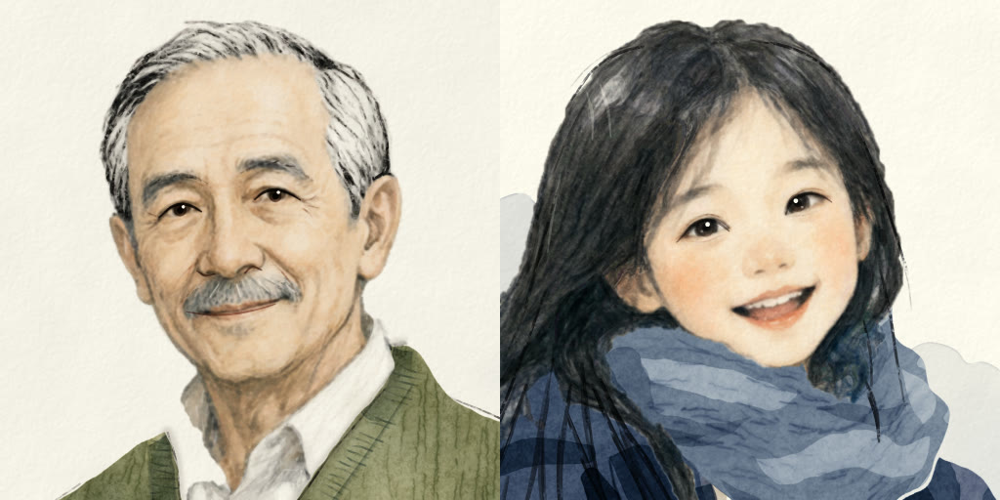
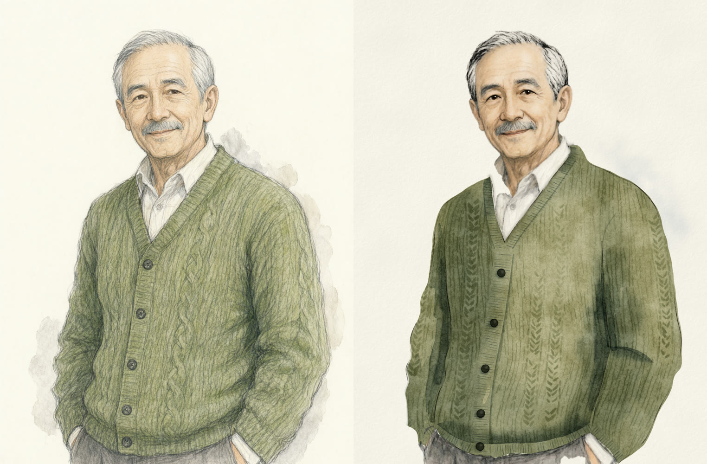
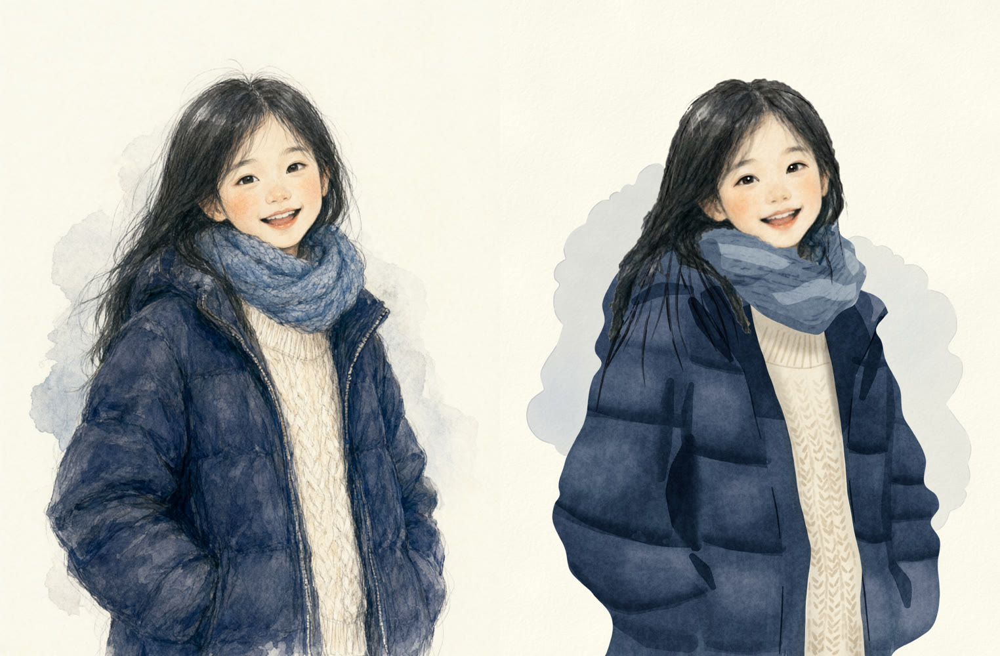

# watercolour-brush

An [Agent Skill](https://docs.claude.com/en/docs/agents-and-tools/agent-skills) for Claude that paints **pencil-and-wash watercolour illustrations as code**: portraits, figures, clothes and small spot art, in a quiet picture-book look.



Each picture is a sheet of cold-press paper and a stack of layers: transparent washes that multiply over each other, wet sessions of brush strokes that melt into one another inside a hard outer edge, graded washes, dry brush, granulation, blooms, lifted lights and broken graphite lines. The same drawing file always paints the same pixels, so a set stays in one hand and any stroke can be adjusted by editing a number. No image model is involved.

The skill is two parts, kept apart on purpose:

- **The brush system** (`references/engine/`): paper, pigment, water and strokes as deterministic Python (numpy + OpenCV). It does exactly what it is told.
- **The painter's guide** (`SKILL.md`, `references/`): how Claude studies a source picture, blocks in the values, decides region by region where the darks and the dry paper go, paints faces and hands by hand, and compares the result with the source until it holds up. A good picture comes from those decisions, not from defaults, so there is no one-click mode.

## Examples

Both examples ship with the skill, with their source pictures and the full painting files. Left: the source; right: the painting.





Paint them yourself. The engine and the examples live in Markdown code blocks, so the plugin holds only text and images. Claude
saves them the first time it paints in a project; by hand:

1. Make a folder (say `watercolour/`) and save the code block of each file in `skills/watercolour-brush/references/engine/`
   (`wash.md`, `regions.md`, `look.md`, `selftest.md`), unchanged, as `wash.py`, `regions.py`, `look.py` and `selftest.py` in it.
2. Install `numpy` and `opencv-python-headless` as their own pages say ([numpy](https://pypi.org/project/numpy/), [opencv-python-headless](https://pypi.org/project/opencv-python-headless/); the engine was tested with numpy 2.5.5
   and opencv-python-headless 5.1.0.95).
3. Copy an example's folder from `skills/watercolour-brush/references/examples/` (`cardigan/`, `winter/`) into `watercolour/examples/`,
   and save its code block (`cardigan.md`, `winter.md`) as `cardigan.py` or `winter.py` inside that copy. The persimmon has no data:
   save `persimmon.md`'s block as `watercolour/examples/persimmon/persimmon.py`.

Then, from `watercolour/`:

```bash
python3 wash.py examples/cardigan/cardigan.py examples/cardigan/out
python3 wash.py examples/winter/winter.py examples/winter/out
python3 wash.py examples/persimmon/persimmon.py out/         # a small persimmon, every kind of mark once
python3 selftest.py
```

## Install

**Claude Code (plugin):**

```
/plugin marketplace add hanlianlu/watercolour-brush
/plugin install watercolour-brush@watercolour-brush
```

**As a plain skill:** copy `skills/watercolour-brush/` into `~/.claude/skills/` (Claude Code), or zip that folder and upload it under Customize → Skills on claude.ai (code execution must be on).

Then ask Claude for something like *"paint this sketch as a watercolour portrait"* or *"add three more portraits that match these watercolours"*.

## What's inside

```
skills/watercolour-brush/
  SKILL.md                         when to use it, the brush system, the painter's guide step by step
  references/engine/wash.md        the engine, wash.py as one code block: paper, washes, brush sessions, knit, graphite, water effects
  references/engine/regions.md     regions.py: proposes areas from a source picture and builds the underdrawing
  references/engine/look.md        look.py: looking tools: values, edges, tones, differences against the source
  references/engine/selftest.md    selftest.py: checks the engine end to end
  references/style.md              the measured style rules (values, edges, faces, hair, ground)
  references/*.md                  starting values, dark cloth, winter clothes, the worked examples
  references/examples/             the two examples above: source, areas.json, finished pictures, and the painting file as a code block
  references/examples/persimmon/   a minimal drawings file, as a code block
```

## What it runs

Only local Python 3 scripts, saved from the code blocks and run with `python3`. They need two libraries, [numpy](https://pypi.org/project/numpy/) and [opencv-python-headless](https://pypi.org/project/opencv-python-headless/), installed the way those pages describe (tested with numpy 2.5.5 and opencv-python-headless 5.1.0.95). The scripts read and write image files in the folders you give them. They make no network requests and send nothing anywhere; no hooks, nothing runs when the plugin is installed.

## License

[MIT](LICENSE), code, docs and example pictures alike. Pictures you paint with it are yours.
